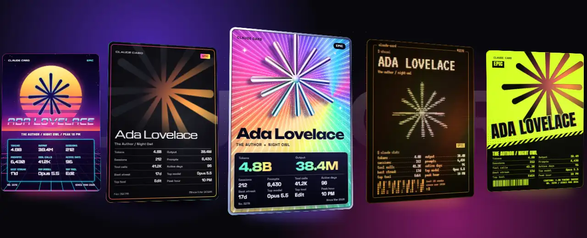
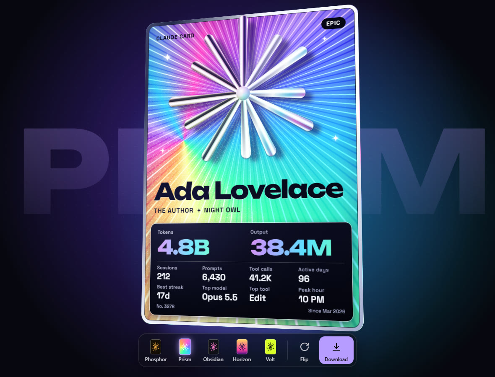
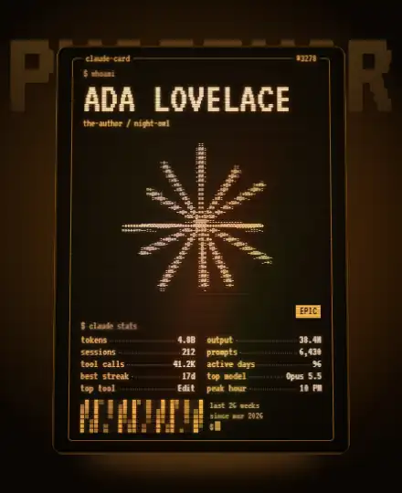
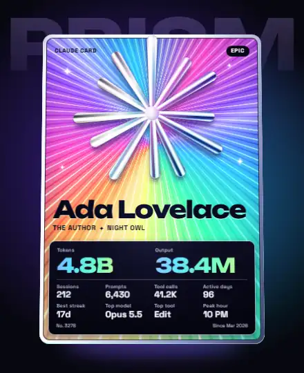
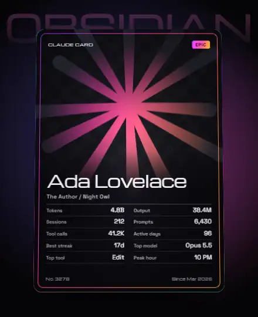
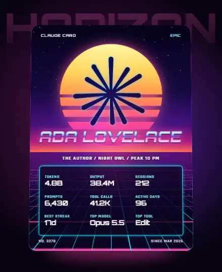
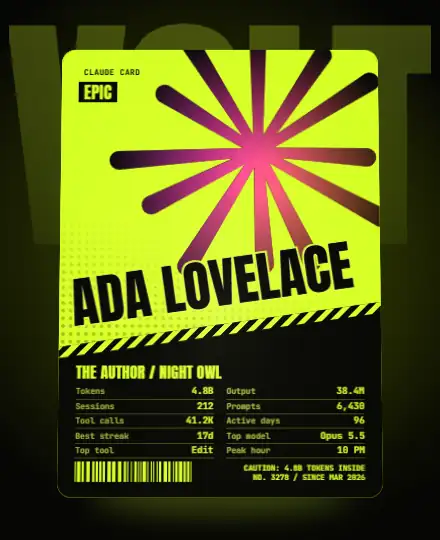
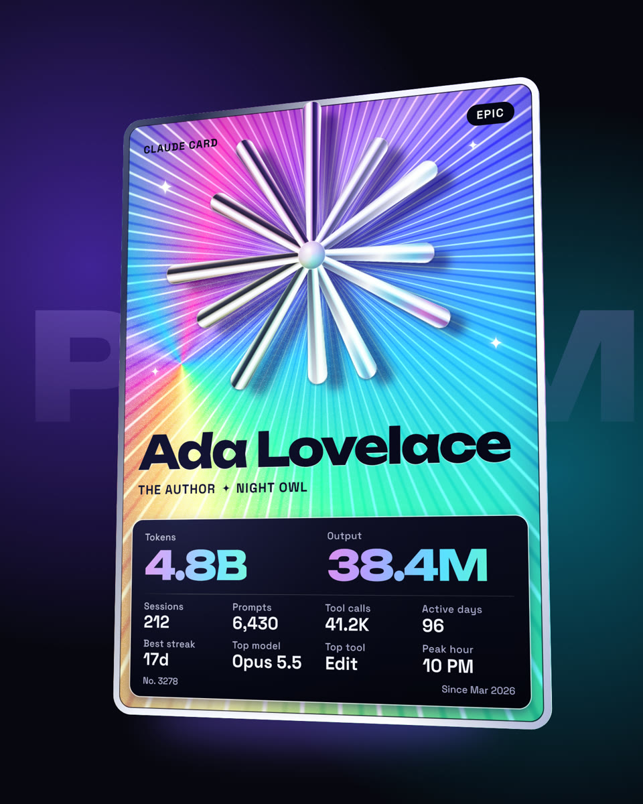

<p align="center"></p>

<p align="center">
  <a href="https://codyspooner.github.io/claude-card/"></a>
  
  
  
  <a href="LICENSE"></a>
</p>

<p align="center">
  <b>Your Claude stats on a holographic 3D trading card.</b><br>
  Type <code>/card</code>, then spin it, flip it, download it and post it.
</p>

<p align="center">
  <a href="https://codyspooner.github.io/claude-card/">Live demo</a> ·
  <a href="#install">Install</a> ·
  <a href="#the-five-designs">Designs</a> ·
  <a href="#whats-on-the-card">Stats</a> ·
  <a href="#what-it-can-see">Privacy</a>
</p>

| Design | The look | The back |
|---|---|---|
| **Phosphor** | An amber CRT terminal with an ASCII spark and a 26-week heat map | CLAUDE fills a giant ASCII spark |
| **Prism** | Full holographic foil, with a chrome spark floating above the card | A foil disc ringed with lettering |
| **Obsidian** | Stealth black, with an oil-slick spark that hides until the light catches it | A magnetic stripe above the spark |
| **Horizon** | A neon sun over a moving grid, with chrome lettering | The sunset, with the grid running to the horizon |
| **Volt** | Acid yellow and black, hazard stripes and oversized angled type | A giant spark between two hazard bands |

## Install

You need [Claude Code](https://claude.com/claude-code), Git and [Node.js 18 or newer](https://nodejs.org).

Run this in PowerShell, bash or zsh:

```bash
git clone --depth 1 https://github.com/CodySpooner/claude-card "$HOME/.claude/skills/card"
```

Then start a new Claude Code session, because Claude Code picks up new skills when a session starts. That's the whole install. It adds one `/card` command and nothing else.

`/card` works anywhere Claude Code runs on your own computer: the terminal, an editor extension or the desktop app's Code tab. It can't run on the web, since your stats are in files on your machine.

## Use it

```
/card
```

Your card opens in your browser. It reads every transcript on each run, so a long history can take about a minute.

To print a handle instead of your account name:

```
/card Ada Lovelace
```

| Control | What it does |
|---|---|
| **Drag** | Spins the card. A hard flick turns it to the other side. |
| **Flip** or <kbd>F</kbd> | Shows the other side |
| **The dock** or <kbd>1</kbd> to <kbd>5</kbd> | Switches the design. Your browser remembers your pick. |
| **Download** | Saves a 1440 × 1800 PNG of the card at the angle you left it |

The dock fades away on its own after a few seconds, so screenshots stay clean too.

<p align="center"></p>

## The five designs

Each card is built from your real numbers, and every one has its own back.

<table><tr>
<td width="50%"><h3>Phosphor</h3><br>Rolling scanlines, a color split as you tilt it and a blinking cursor.</td>
<td width="50%"><h3>Prism</h3><br>The foil and the chrome both follow the light, and stars twinkle across it.</td>
</tr><tr>
<td width="50%"><h3>Obsidian</h3><br>A pool of color slides across the spark as you tilt it.</td>
<td width="50%"><h3>Horizon</h3><br>The grid rolls toward you the whole time.</td>
</tr><tr>
<td width="50%"><h3>Volt</h3><br>Your name splits into color as you tilt it, and the barcode comes from your card number.</td>
<td width="50%"><h3>What a download looks like</h3><br>This picture came straight from the Download button.</td>
</tr></table>

<sub>Every picture here uses a made-up sample card for Ada Lovelace, not anyone's real stats.</sub>

## What's on the card

| Stat | What it counts |
|---|---|
| **Tokens** | Everything sent and received, cache included |
| **Output** | The tokens Claude wrote back |
| **Sessions** | Separate Claude Code sessions |
| **Prompts** | Messages you typed yourself, not tool results or subagent turns |
| **Tool calls** | Every command, edit, read and search |
| **Active days** | Days you used Claude Code |
| **Best streak** | Your most active days in a row |
| **Top model** | The model that wrote the most output |
| **Top tool** | The built-in tool Claude used most |
| **Peak hour** | The hour you type the most |

**Your rarity comes from your output tokens:** Common, then Uncommon at 200K, Rare at 2M, Epic at 20M and Legendary at 100M.

**Your title comes from your top tool:**

| Top tool | Title |
|---|---|
| Bash or PowerShell | The Operator |
| Edit or Write | The Author |
| Read, Grep or Glob | The Scholar |
| Web search or fetch | The Explorer |
| Agent or Task | The Commander |
| Anything else | The Builder |

**Your shift comes from your peak hour:** Early Bird from 5 AM, Day Shift from 9 AM, Golden Hour from 5 PM and Night Owl from 9 PM.

## What it can see

`/card` runs a small script on your machine, with no dependencies and no network calls of its own.

- **It reads** your transcripts in `~/.claude/projects`, and your display name and start date from `~/.claude.json`. It counts things in the transcripts and doesn't keep what they say.
- **It writes** one file, `~/.claude/claude-card/card.html`. That file holds your name and the numbers you see on the card, and never your email, your prompts or anything you wrote.
- **It sends nothing.** Your stats leave your machine only if you post them. The card page loads its fonts from Google Fonts, so Google sees that request, but not your stats.

## Update or uninstall

To update:

```bash
git -C "$HOME/.claude/skills/card" pull
```

To uninstall, delete the `~/.claude/skills/card` folder. Your saved card is in `~/.claude/claude-card`, so delete that folder too if you don't want it.

## Troubleshooting

- **`/card` isn't listed.** Start a new session, then check that `~/.claude/skills/card/SKILL.md` exists. If you set `CLAUDE_CONFIG_DIR`, clone into `$CLAUDE_CONFIG_DIR/skills/card` instead.
- **It says Node isn't found.** Install [Node.js 18 or newer](https://nodejs.org), then start a new session.
- **The card has the wrong name.** Run `/card Your Name`. Without a name, it uses your Claude account name, then your Git name, then your computer's username.
- **The card is blank.** It has no history to count yet. Run `/card` again after a few sessions.
- **Download doesn't work.** It's tested in Chrome and Edge. In another browser it may tell you it can't save the picture, and a screenshot works just as well.
- **The fonts look plain.** They come from Google Fonts, so they need an internet connection.

## Repository layout

```
SKILL.md              The /card command. It has to stay at the top level.
card.mjs              Counts your stats and writes the card page.
card.html             The card page: the viewer, the download and all five designs.
card.test.mjs         The tests.
docs/                 The website, served by GitHub Pages.
  index.html          The site itself.
  demo.html           The sample card. make-pictures.mjs builds it from card.html.
  showcase.html       Stages the sample card for the pictures.
  make-pictures.mjs   Draws every picture in docs/images.
  images/             The README's and the site's pictures.
  fonts/              Inter and JetBrains Mono, for the site.
```

## Development

To try a card with sample numbers, without reading your history:

```bash
node card.mjs --demo
```

To run the tests:

```bash
node --test
```

To redraw the pictures, which needs Node 24, Chrome or Edge, and ffmpeg:

```bash
node docs/make-pictures.mjs
```

To add a design, add an entry to `DESIGNS` in `card.html`, with its colors under `[data-design=...]`.

---

<p align="center">Made by <a href="https://github.com/CodySpooner">Xody</a> · <a href="LICENSE">MIT license</a><br><sub>An unofficial community project, not made by or affiliated with Anthropic.</sub></p>
